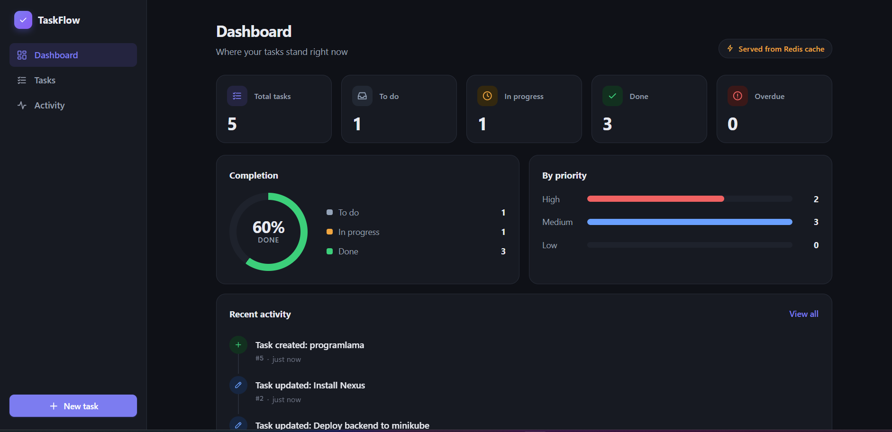
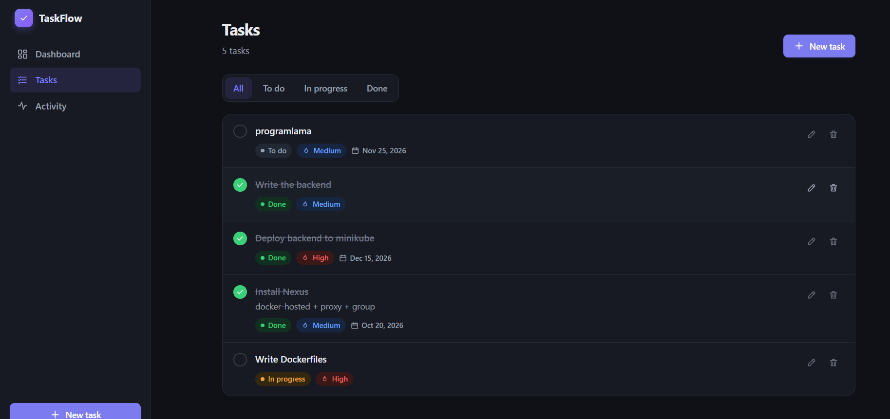
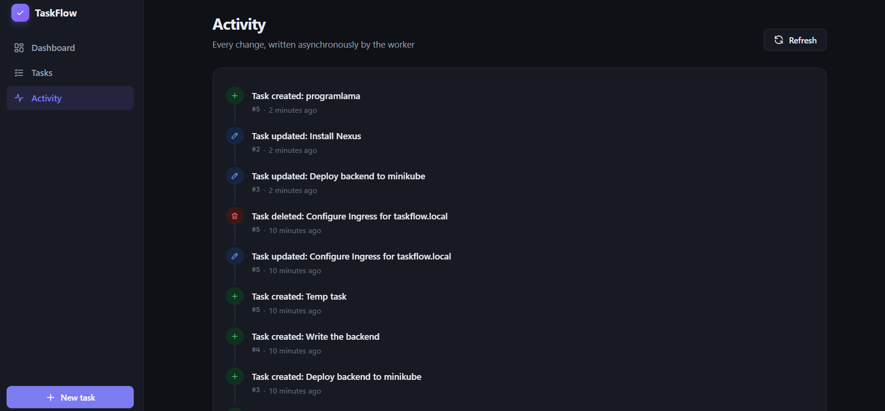
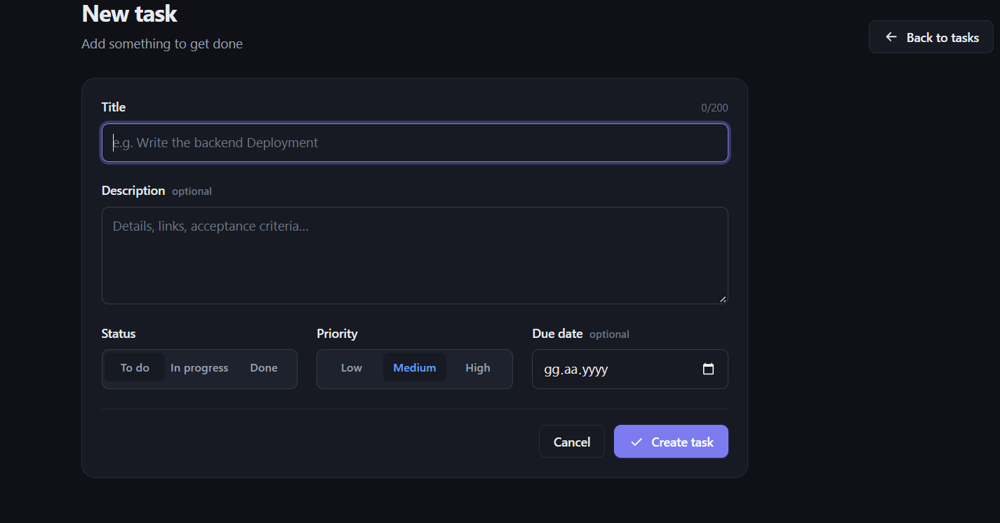
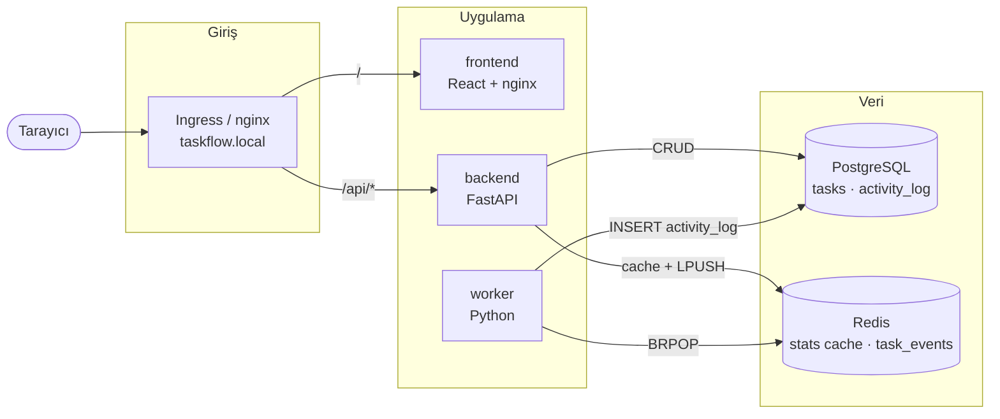
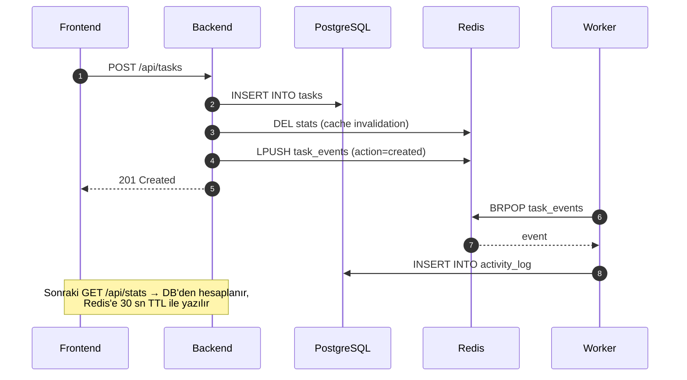

<div align="center">

# TaskFlow

**Kubernetes öğrenmek için gerçek bir mikroservis projesi**

FastAPI · React · PostgreSQL · Redis · Worker — container'a, registry'ye ve Kubernetes'e hazır


</div>

---

TaskFlow basit bir görev yönetimi uygulamasıdır. Uygulama **bilerek sade** tutuldu; asıl amaç onu
container'a koymak, kendi registry'mizden (Nexus) dağıtmak ve Kubernetes üzerinde adım adım
çalıştırarak **CKA sınavına** hazırlanmaktır.

Buna rağmen kod "oyuncak" değildir: ayrı liveness/readiness endpoint'leri, ayrı migration komutu,
graceful shutdown, kuyruk tabanlı asenkron işleme, cache invalidation ve 111 otomatik test içerir.
Her biri ileride bir Kubernetes kavramına (probe, Job, CronJob, rolling update…) karşılık gelir.

## Ekran Görüntüleri

<p align="center">
  
  <br>
  <sub><b>Dashboard</b> — görev sayıları, tamamlanma oranı, öncelik dağılımı ve son aktiviteler. Sağ üstteki rozet verinin Redis cache'ten mi PostgreSQL'den mi geldiğini gösterir.</sub>
</p>

<table>
  <tr>
    <td width="50%" align="center">
      
      <br><sub><b>Görevler</b> — durum filtresi, tek tıkla tamamlama, gecikme uyarısı</sub>
    </td>
    <td width="50%" align="center">
      
      <br><sub><b>Aktivite</b> — worker'ın kuyruktan okuyup yazdığı kayıtlar</sub>
    </td>
  </tr>
  <tr>
    <td width="50%" align="center">
      
      <br><sub><b>Görev formu</b> — ekleme ve düzenleme</sub>
    </td>
    <td width="50%" valign="middle">
      <b>Her sayfanın altında</b> cevap veren backend'in versiyonu ve hostname'i görünür.
      Kubernetes'te hostname = Pod adı olduğu için:
      <ul>
        <li>Sayfayı yenileyip farklı Pod adları görmek → <b>Service load balancing</b></li>
        <li>Versiyonun değiştiğini görmek → <b>rolling update / rollback</b></li>
      </ul>
    </td>
  </tr>
</table>

## İçindekiler

- [Özellikler](#özellikler)
- [Mimari](#mimari)
- [Teknolojiler](#teknolojiler)
- [Proje Yapısı](#proje-yapısı)
- [Yerelde Çalıştırma](#yerelde-çalıştırma)
- [Testler](#testler)
- [Konfigürasyon](#konfigürasyon)
- [API](#api)
- [Veri Modeli](#veri-modeli)

## Özellikler

| Alan | Detay |
|---|---|
| **Görev yönetimi** | Oluşturma, düzenleme, silme; durum (`todo` / `in_progress` / `done`), öncelik ve bitiş tarihi |
| **Dashboard** | Durum ve öncelik dağılımı, tamamlanma oranı, geciken görevler |
| **Stats cache** | İstatistikler Redis'te 30 sn TTL ile tutulur, her yazma işleminde silinir |
| **Asenkron aktivite** | Backend her değişikliği Redis kuyruğuna atar, worker okuyup veritabanına yazar |
| **Dayanıklılık** | Redis çökerse API çalışmaya devam eder (cache atlanır); DB yazılamazsa event kuyruğa geri konur, kaybolmaz |
| **Temizlik işi** | Eski aktivite kayıtlarını silen tek seferlik komut (CronJob için) |
| **Arayüz** | Açık / koyu tema, mobil uyumlu, yükleme ve hata durumları |

## Mimari



| Servis | Görevi | Port |
|---|---|---|
| **frontend** | React (Vite) build'i, nginx ile statik olarak sunulur | 8080 |
| **backend** | REST API, CRUD, stats cache, event yayınlama | 8000 |
| **worker** | `task_events` kuyruğunu dinler, `activity_log`'a yazar | – |
| **postgres** | Kalıcı veri | 5432 |
| **redis** | Stats cache + event kuyruğu | 6379 |

Ek iş yükleri:

| İş yükü | Komut | Kubernetes karşılığı |
|---|---|---|
| **migrate** | `alembic upgrade head` (backend imajı) | Job / initContainer |
| **cleanup** | `python -m app.cleanup` (worker imajı) | CronJob |

### Akış: "Görev oluştur"



## Teknolojiler

| Katman | Teknoloji |
|---|---|
| Backend | Python 3.12, FastAPI, SQLAlchemy 2, Alembic, Pydantic Settings, psycopg 3 |
| Worker | Python 3.12, redis-py, SQLAlchemy Core |
| Frontend | React 19, TypeScript, React Router, Vite |
| Veri | PostgreSQL 17, Redis 7 |
| Test | pytest, fakeredis, Vitest, Testing Library |
| Kalite | Ruff (lint + format), TypeScript strict mode |

## Proje Yapısı

```
taskflow-k8s/
├── backend/
│   ├── app/
│   │   ├── routers/          # system (health, version), tasks, stats, activity
│   │   ├── config.py         # env var'lardan ayarlar (12-factor)
│   │   ├── models.py         # SQLAlchemy modelleri
│   │   ├── cache.py          # stats cache (Redis)
│   │   ├── events.py         # task_events yayınlama
│   │   └── main.py           # FastAPI uygulaması
│   ├── alembic/              # veritabanı migration'ları
│   └── tests/
├── worker/
│   ├── app/
│   │   ├── main.py           # kuyruk tüketicisi
│   │   ├── cleanup.py        # eski aktiviteleri silen komut
│   │   └── healthcheck.py    # heartbeat kontrolü (exec probe)
│   └── tests/
├── frontend/
│   ├── src/
│   │   ├── pages/            # Dashboard, Tasks, TaskForm, Activity
│   │   ├── components/
│   │   └── api.ts            # tipli API istemcisi
│   └── vite.config.ts
├── docs/images/              # ekran görüntüleri
├── .env.example              # tüm konfigürasyon değişkenleri
└── .gitattributes            # LF satır sonu (Windows → Linux container)
```

## Yerelde Çalıştırma

> [!NOTE]
> Dockerfile'lar ve `docker compose` ile tek komutla çalıştırma **Faz 2**'de eklenecek.
> O zamana kadar servisler aşağıdaki gibi ayrı ayrı çalıştırılır.

### Gereksinimler

- Python **3.12**
- Node.js **22.22+**
- Erişilebilir bir **PostgreSQL 17** ve **Redis 7**

### 1. Konfigürasyon

```bash
cp .env.example .env
```

`.env` içinde `DB_HOST` ve `REDIS_HOST` değerlerini kendi ortamına göre (ör. `localhost`) düzenle.

Uygulama `.env` dosyasını **kendisi okumaz**; değerler ortam değişkeni olarak verilmelidir
(Kubernetes'te ConfigMap ve Secret ile verilecek). Terminalde yüklemek için:

```bash
# Linux / macOS / Git Bash
set -a; source .env; set +a
```

```powershell
# PowerShell
Get-Content .env | Where-Object { $_ -match '^[^#].*=' } | ForEach-Object {
    $name, $value = $_ -split '=', 2
    Set-Item "env:$name" $value
}
```

### 2. Backend

```bash
cd backend
python -m venv .venv
source .venv/bin/activate          # Windows: .venv\Scripts\activate
pip install -r requirements-dev.txt

alembic upgrade head               # tabloları oluşturur
uvicorn app.main:app --reload --port 8000
```

API dokümantasyonu (Swagger): http://localhost:8000/api/docs

### 3. Worker

Ayrı bir terminalde, aynı ortam değişkenleriyle:

```bash
cd worker
python -m venv .venv
source .venv/bin/activate          # Windows: .venv\Scripts\activate
pip install -r requirements-dev.txt

python -m app.main
```

### 4. Frontend

```bash
cd frontend
npm ci
npm run dev
```

Uygulama: http://localhost:5173 — `/api` istekleri Vite tarafından backend'e (`http://localhost:8000`)
yönlendirilir. Farklı bir adres için `API_PROXY_TARGET` değişkenini kullan.

## Testler

Testler PostgreSQL veya Redis **gerektirmez**: backend ve worker SQLite + fakeredis, frontend ise
sahte bir `fetch` kullanır.

| Servis | Komut | Test sayısı |
|---|---|---|
| Backend | `cd backend && pytest` | 40 |
| Worker | `cd worker && pytest` | 36 |
| Frontend | `cd frontend && npm test` | 35 |

Kalite kontrolleri:

```bash
cd backend && ruff check . && ruff format --check .
cd worker  && ruff check . && ruff format --check .
cd frontend && npm run typecheck && npm run build
```

Testlerin kapsadığı bazı senaryolar:

- Redis çökükken görev yazma ve istatistik okuma çalışmaya devam eder
- DB çökükken API `500` değil `503 Database unavailable` döner, readiness `503` olur
- Worker DB'ye yazamazsa event kuyruğa geri konur ve sırası korunur
- Bozuk bir mesaj kuyruğu tıkamaz, atlanır
- Worker durdurulduğunda döngüden temiz çıkar

## Konfigürasyon

Tüm ayarlar ortam değişkeni ile verilir; kodda sabit host veya şifre yoktur. Host ve kimlik
bilgileri için varsayılan değer **bilerek** tanımlanmamıştır: eksik bir ConfigMap/Secret, uygulamanın
açılışta net bir hata ile durmasına yol açar.

| Değişken | Örnek | Kullanan | Kubernetes'te |
|---|---|---|---|
| `APP_ENV` | `production` | backend | ConfigMap |
| `APP_VERSION` | `1.0.0` | backend, worker | ConfigMap / Deployment env |
| `LOG_LEVEL` | `INFO` | backend, worker | ConfigMap |
| `DB_HOST` | `postgres` | backend, worker | ConfigMap |
| `DB_PORT` | `5432` | backend, worker | ConfigMap |
| `DB_NAME` | `taskflow` | backend, worker | ConfigMap |
| `DB_USER` | `taskflow` | backend, worker | Secret |
| `DB_PASSWORD` | `***` | backend, worker | **Secret** |
| `REDIS_HOST` | `redis` | backend, worker | ConfigMap |
| `REDIS_PORT` | `6379` | backend, worker | ConfigMap |
| `REDIS_PASSWORD` | `***` | backend, worker | **Secret** |
| `CACHE_TTL_SECONDS` | `30` | backend | ConfigMap |
| `ACTIVITY_RETENTION_DAYS` | `7` | cleanup | ConfigMap |
| `HEARTBEAT_FILE` | `/tmp/worker-heartbeat` | worker | – |
| `HEARTBEAT_MAX_AGE_SECONDS` | `30` | worker healthcheck | – |

## API

Tüm endpoint'ler `/api` altındadır. İnteraktif dokümantasyon: `/api/docs`.

| Method | Path | Açıklama |
|---|---|---|
| `GET` | `/api/health/live` | Process ayakta mı? Her zaman `200` — **livenessProbe** |
| `GET` | `/api/health/ready` | DB ve Redis erişilebilir mi? Değilse `503` — **readinessProbe** |
| `GET` | `/api/version` | `{"version", "hostname", "env"}` |
| `GET` | `/api/tasks?status=` | Görev listesi (isteğe bağlı durum filtresi) |
| `POST` | `/api/tasks` | Görev oluştur |
| `GET` | `/api/tasks/{id}` | Görev detayı |
| `PUT` | `/api/tasks/{id}` | Görevi güncelle (tam değiştirme) |
| `DELETE` | `/api/tasks/{id}` | Görevi sil |
| `GET` | `/api/stats` | Redis cache'li istatistik (`cached: true/false`) |
| `GET` | `/api/activity?limit=50` | Son aktiviteler (1–200) |

<details>
<summary>Örnek istekler</summary>

```bash
# Görev oluştur
curl -X POST http://localhost:8000/api/tasks \
  -H "Content-Type: application/json" \
  -d '{"title": "Deploy backend", "priority": "high", "due_date": "2026-12-15"}'

# Sadece devam edenler
curl "http://localhost:8000/api/tasks?status=in_progress"

# İstatistik (ikinci istekte "cached": true)
curl http://localhost:8000/api/stats

# Readiness (DB veya Redis yoksa 503)
curl -i http://localhost:8000/api/health/ready
```

</details>

## Veri Modeli

**tasks**

| Kolon | Tip | Not |
|---|---|---|
| `id` | serial PK | |
| `title` | varchar(200) | zorunlu |
| `description` | text | opsiyonel |
| `status` | enum `todo` · `in_progress` · `done` | varsayılan `todo`, indeksli |
| `priority` | enum `low` · `medium` · `high` | varsayılan `medium` |
| `due_date` | date | opsiyonel |
| `created_at` / `updated_at` | timestamptz | |

**activity_log**

| Kolon | Tip | Not |
|---|---|---|
| `id` | serial PK | |
| `task_id` | int | FK **değil** — görev silinse de log kalır |
| `action` | varchar(20) | `created` · `updated` · `deleted` |
| `message` | text | |
| `created_at` | timestamptz | olayın gerçekleştiği an, indeksli |

Şema yalnızca backend'deki Alembic migration'ları ile yönetilir; worker tabloyu sadece kullanır.


<div align="center">

**Berkan Karayel** · [GitHub](https://github.com/berkankarayel)

</div>
